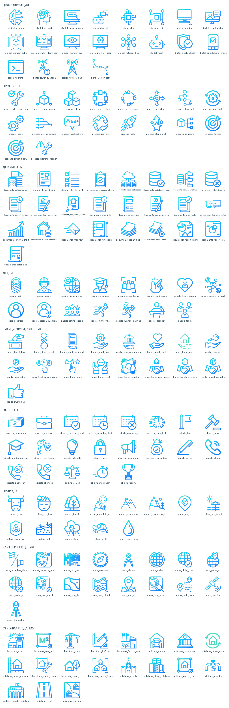
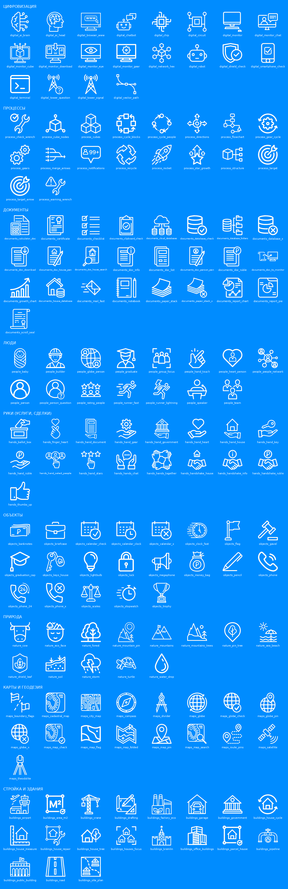

# Каталог иконок

Все иконки извлечены из корпоративного шаблона Росреестра. Каждая есть в двух вариантах:

* `assets/icons/blue/<id>.png` — синий градиент, **для белого фона** (основной вариант);
* `assets/icons/white/<id>.png` — белые, **для синих и градиентных плашек**.

В спецификации слайда иконка указывается по `id` (без `.png`), например `"icon": "maps_cadastral_map"`.
Белый вариант библиотека подставляет сама, если иконка стоит на синем фоне.

## Цифровизация

| id | Значение / когда использовать |
|---|---|
| `digital_ai_brain` | Нейросеть, интеллектуальная обработка |
| `digital_ai_head` | Искусственный интеллект, аналитика |
| `digital_browser_www` | Сайт, веб-портал, электронная подача |
| `digital_chatbot` | Чат-бот, виртуальный помощник |
| `digital_chip` | Микросхема, процессор, технологии |
| `digital_circuit` | Электронная схема, интеграция |
| `digital_monitor` | Компьютер, рабочее место |
| `digital_monitor_chat` | Онлайн-консультация, ВКС, электронное обращение |
| `digital_monitor_cube` | 3D-модель на мониторе, цифровой двойник |
| `digital_monitor_download` | Загрузка данных, выгрузка |
| `digital_monitor_eye` | Мониторинг, просмотр, контроль |
| `digital_monitor_gear` | Настройка системы, сервис |
| `digital_network_hex` | Сеть, взаимосвязи, платформа |
| `digital_robot` | Робот, автоматизация |
| `digital_shield_check` | Информационная безопасность, защита |
| `digital_smartphone_check` | Мобильное приложение, Госуслуги, подтверждение |
| `digital_terminal` | Командная строка, ИТ-система |
| `digital_tower_question` | Связь, вопрос по сети |
| `digital_tower_signal` | Связь, сеть, передача данных |
| `digital_vector_path` | Векторные данные, границы, проектирование |

## Процессы

| id | Значение / когда использовать |
|---|---|
| `process_check_wrench` | Исправление, устранение замечаний |
| `process_cube_nodes` | Модель, связи |
| `process_cubes` | Модули, компоненты |
| `process_cycle_blocks` | Цикл процесса, этапы внедрения |
| `process_cycle_people` | Круговорот, межведомственное взаимодействие |
| `process_directions` | Направления, развитие |
| `process_flowchart` | Блок-схема, регламент |
| `process_gear_cycle` | Непрерывный процесс, оптимизация |
| `process_gears` | Механизм, взаимодействие, процессы |
| `process_merge_arrows` | Объединение потоков |
| `process_notifications` | Уведомления, подписчики, соцсети |
| `process_recycle` | Обновление, обмен |
| `process_rocket` | Запуск, старт проекта, ускорение |
| `process_star_growth` | Рост качества, улучшение |
| `process_structure` | Структура, иерархия |
| `process_target` | Цель, ориентир |
| `process_target_arrow` | Достижение цели, KPI |
| `process_warning_wrench` | Внимание, исключение, риск |

## Документы

| id | Значение / когда использовать |
|---|---|
| `documents_calculator_doc` | Расчет, кадастровая стоимость, учет |
| `documents_certificate` | Свидетельство, сертификат |
| `documents_checklist` | Чек-лист, требования, контроль |
| `documents_clipboard_check` | Проверка, согласование |
| `documents_cloud_databases` | Облако, платформа данных |
| `documents_database_check` | База данных, ЕГРН, достоверные сведения |
| `documents_database_folders` | Хранилище, реестр |
| `documents_database_x` | Ошибка в данных |
| `documents_doc_download` | Получение документа, выписка |
| `documents_doc_house_pen` | Заявление по объекту недвижимости, регистрация прав |
| `documents_doc_house_search` | Поиск сведений об объекте, ЕГРН |
| `documents_doc_info` | Справочная информация |
| `documents_doc_list` | Документ, перечень |
| `documents_doc_person_pen` | Заявление гражданина, анкета |
| `documents_doc_ruble` | Платежный документ, госпошлина |
| `documents_doc_to_monitor` | Перевод документов в электронный вид |
| `documents_growth_chart` | Рост показателей, динамика |
| `documents_house_database` | Реестр недвижимости, ипотека |
| `documents_mail_fast` | Электронная почта, быстрая отправка |
| `documents_notebook` | Записи, журнал |
| `documents_paper_stack` | Массив документов, обращения |
| `documents_paper_stack_x` | Отказ, возврат документов |
| `documents_report_chart` | Аналитический отчет, динамика |
| `documents_report_pie` | Отчет, структура |
| `documents_scroll_seal` | Закон, нормативный акт, официальный документ |

## Люди

| id | Значение / когда использовать |
|---|---|
| `people_baby` | Семья, дети, материнский капитал |
| `people_builder` | Строитель, застройщик, кадастровый инженер |
| `people_globe_person` | Международный, глобальный пользователь |
| `people_graduate` | Обучение, квалификация |
| `people_group_focus` | Целевая аудитория |
| `people_hand_touch` | Касание, выбор, интерактив |
| `people_heart_person` | Забота о гражданах, клиентоориентированность |
| `people_people_network` | Сообщество, взаимодействие |
| `people_person` | Пользователь, гражданин |
| `people_person_question` | Вопрос заявителя, консультация |
| `people_rating_people` | Рейтинг, оценка, удовлетворенность |
| `people_runner_fast` | Скорость, оперативность |
| `people_runner_lightning` | Ускорение, энергия |
| `people_speaker` | Выступление, консультации, приём |
| `people_team` | Команда, рабочая группа, пользователи |

## Руки (услуги, сделки)

| id | Значение / когда использовать |
|---|---|
| `hands_ballot_box` | Голосование, выбор, предложения |
| `hands_finger_heart` | Благодарность, лояльность |
| `hands_hand_document` | Выдача документа |
| `hands_hand_gear` | Услуга, сервис, эффект |
| `hands_hand_government` | Государственная услуга |
| `hands_hand_heart` | Забота, социальная поддержка |
| `hands_hand_house` | Жилье, оформление недвижимости |
| `hands_hand_key` | Ключи, ипотека, новое жилье |
| `hands_hand_ruble` | Финансы, платеж, субсидия |
| `hands_hand_select_people` | Выбор, голосование |
| `hands_hand_stars` | Оценка качества услуг |
| `hands_hands_chat` | Диалог, обратная связь |
| `hands_hands_together` | Сотрудничество, партнерство |
| `hands_handshake_house` | Сделка с недвижимостью |
| `hands_handshake_info` | Соглашение, информирование |
| `hands_handshake_ruble` | Сделка, договор купли-продажи |
| `hands_thumbs_up` | Одобрение, результат |

## Объекты

| id | Значение / когда использовать |
|---|---|
| `objects_banknotes` | Деньги, платежи |
| `objects_briefcase` | Бизнес, юридические лица |
| `objects_calendar_check` | Срок выполнен, дата |
| `objects_calendar_clock` | Сроки, график |
| `objects_calendar_x` | Просрочка, отмена |
| `objects_clock_fast` | Быстрые сроки, оперативность |
| `objects_flag` | Цель, достижение, флаг |
| `objects_gavel` | Суд, решение, закон |
| `objects_graduation_cap` | Образование |
| `objects_keys_house` | Ключи от дома, право собственности |
| `objects_lightbulb` | Идея, предложение, инновации |
| `objects_lock` | Защита, безопасность, запрет |
| `objects_megaphone` | СМИ, информирование, объявления |
| `objects_money_bag` | Бюджет, доходы |
| `objects_pencil` | Редактирование, подпись |
| `objects_phone` | Телефон, горячая линия |
| `objects_phone_24` | Горячая линия, круглосуточная поддержка |
| `objects_phone_x` | Пропущенный звонок, отказ |
| `objects_scales` | Право, правосудие, баланс |
| `objects_stopwatch` | Сроки, норматив времени |
| `objects_trophy` | Лидерство, награда, рейтинг |

## Природа

| id | Значение / когда использовать |
|---|---|
| `nature_cow` | Сельское хозяйство, сельхозземли |
| `nature_eco_face` | Экология, благополучие |
| `nature_forest` | Лес, лесной фонд |
| `nature_mountain_pin` | Местоположение природного объекта |
| `nature_mountains` | Рельеф, территория |
| `nature_mountains_trees` | Ландшафт, природные территории |
| `nature_pin_tree` | Лесной участок, зеленые зоны |
| `nature_sea_beach` | Водный объект, береговая полоса |
| `nature_shield_leaf` | Охрана окружающей среды |
| `nature_soil` | Почва, земельные ресурсы, мелиорация |
| `nature_storm` | Стихийное бедствие, ЧС |
| `nature_turtle` | Охрана природы, ООПТ |
| `nature_water_drop` | Вода, зоны затопления, водные ресурсы |

## Карты и геодезия

| id | Значение / когда использовать |
|---|---|
| `maps_boundary_flags` | Установление границ |
| `maps_cadastral_map` | Кадастровая карта, рельеф |
| `maps_city_map` | Карта города, кварталы |
| `maps_compass` | Ориентир, навигация |
| `maps_divider` | Геодезия, измерения, проектирование |
| `maps_globe` | Глобус, пространственные данные |
| `maps_globe_check` | Пространственные данные проверены |
| `maps_globe_pin` | Геолокация |
| `maps_globe_x` | Ошибка пространственных данных |
| `maps_map_check` | Проверенные границы, согласование |
| `maps_map_flag` | Карта, межевание, границы |
| `maps_map_folded` | Карта, маршрут |
| `maps_map_pin` | Точка на карте, адрес |
| `maps_map_search` | Поиск на карте, анализ территории |
| `maps_route_pins` | Маршрут, этапы |
| `maps_satellite` | Спутник, ДЗЗ, ГЛОНАСС |
| `maps_theodolite` | Геодезический прибор, кадастровые работы |

## Стройка и здания

| id | Значение / когда использовать |
|---|---|
| `buildings_airport` | Транспортная инфраструктура |
| `buildings_area_m2` | Площадь, земельный участок, м² |
| `buildings_crane` | Строительство, застройщик |
| `buildings_drafting` | Проект, чертеж |
| `buildings_factory_eco` | Промышленность |
| `buildings_garage` | Гараж, машино-место |
| `buildings_government` | Госорган, Росреестр, учреждение |
| `buildings_house_cycle` | Оформление недвижимости, «построил — оформи» |
| `buildings_house_measure` | Обмеры, технический план |
| `buildings_house_repair` | Реконструкция, ремонт |
| `buildings_house_tree` | Частный дом, ИЖС |
| `buildings_houses_focus` | Жилой комплекс, выявление объектов |
| `buildings_kremlin` | Государство, федеральный уровень |
| `buildings_office_buildings` | Многоэтажная застройка, бизнес-центр |
| `buildings_parcel_house` | Участок с домом, права на землю |
| `buildings_pipeline` | Инженерные сети, газопровод |
| `buildings_public_building` | Общественное здание, администрация |
| `buildings_road` | Дорога, линейный объект |
| `buildings_site_plan` | Генплан, планировка территории |

## Белый вариант

