# Каталог макетов

Для каждого макета приведены: назначение, поля (обязательные выделены **жирным**), рекомендуемые лимиты и превью. Полные примеры — `examples/forum_2026.json` (реальный доклад) и `examples/showcase.json`.

> Лимиты символов ориентировочные. Сборщик автоматически уменьшает кегль, а при сильном переполнении выдаёт `⚠`. Правильная реакция на предупреждение — сократить текст, а не мириться с мелким шрифтом.

---

## `title` — титульный слайд

| Поле | Описание | Лимит |
|---|---|---|
| **`title`** | Тема доклада | ≤ 90 символов (3 строки) |
| `kicker` | Мероприятие, дата (зелёная строка над заголовком) | ≤ 50 |
| `author` | ФИО докладчика | ≤ 30 |
| `role` | Должность | ≤ 70 |

## `section` — разделитель раздела

**`title`** (≤ 40), `number` (номер раздела, выводится как «01»), `subtitle` (≤ 80).

## `final` — финальный слайд

`title` (по умолчанию «Спасибо за внимание!»), `subtitle` (например, «Готова ответить на ваши вопросы»), `footer` (название управления, контакты).

---

## `kpi_table` — цифры + таблица
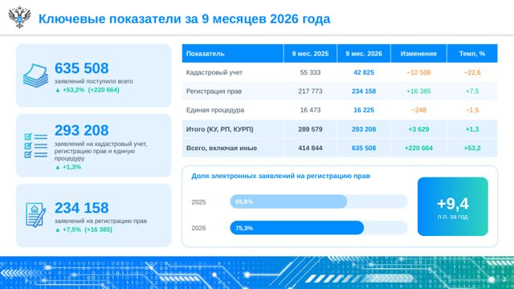

Ключевые показатели периода и таблица сравнения.

| Поле | Описание | Лимит |
|---|---|---|
| **`title`** | | ≤ 60 |
| **`table`** | Таблица (см. spec-format) | до 6 строк с `progress`, до 9 без |
| `kpis` | Список KPI слева | 1–4; `label` ≤ 70 |
| `progress` | Прогресс-бары под таблицей | 2–3 полосы + `badge` |
| `intro` | Вводная строка | ≤ 120 |

## `kpi_chart` — цифры + диаграмма
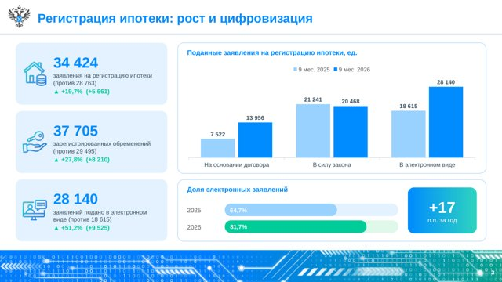

Поля: **`title`**, **`chart`**, `kpis` (1–4), `chart_title`, `progress`, `intro`. Категорий в диаграмме — до 6, рядов — до 3.

## `metric_bars` — норматив / факт
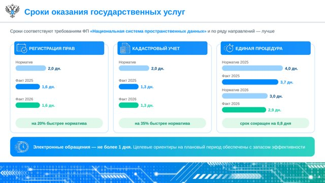

Сравнение сроков или значений с нормативом.

| Поле | Описание |
|---|---|
| **`title`** | |
| **`groups`** | 1–4 группы: `{title, icon, bars:[{label, value, kind}], badge, unit}` |
| `intro` | Вводная строка (≤ 130) |
| `callout` | Выноска внизу `{icon, text, style}` |
| `unit` | Единица по умолчанию (`"дн."`, `"%"`) |

`kind`: `plan` — бледно-синий (норматив, прошлый период), `fact` — синий, `fact2` — зелёный (текущий / лучший), `warn` — оранжевый (хуже норматива). В группе 2–4 полосы. Длина полос считается от максимума по всему слайду.

## `cards` — сетка карточек
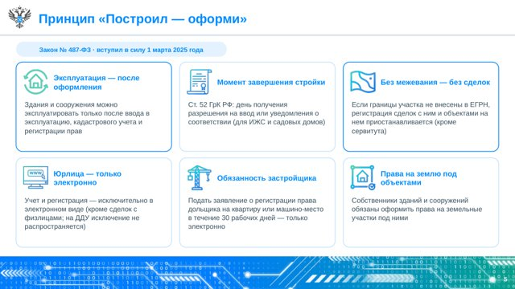

Равнозначные изменения, требования, направления.

| Поле | Описание | Лимит |
|---|---|---|
| **`title`** | | ≤ 60 |
| **`cards`** | `{icon, title, text, highlight}` | 2–6 (до 8); `title` ≤ 35, `text` ≤ 170 (при 6 карточках), ≤ 260 (при 2–3) |
| `intro` | Пилюля над карточками (реквизиты закона, дата) | ≤ 90 |
| `columns` | Принудительное число колонок | |

Раскладка: 2 → 2×1, 3 → 3×1, 4 → 2×2, 5–6 → 3×2, 7–8 → 4×2. Через `highlight: true` выделяйте 1–2 главные карточки.

## `numbered` — нумерованный перечень + факты
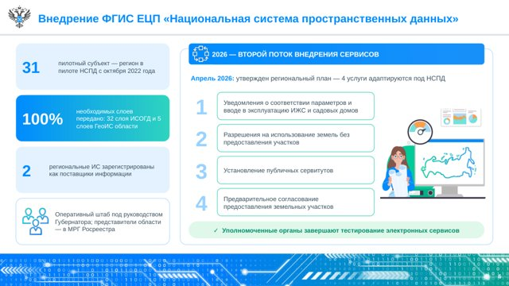

| Поле | Описание | Лимит |
|---|---|---|
| **`title`** | | ≤ 60 |
| **`items`** | Пункты перечня (строки) | 2–5, каждый ≤ 110 |
| `tiles` | Плитки слева: `{value, label, dark}` или `{icon, label}` | до 4; `value` ≤ 5 символов, `label` ≤ 80 |
| `header`, `header_icon` | Синяя плашка-заголовок панели | ≤ 50 |
| `lead` | Строка под заголовком | ≤ 100 |
| `illustration` | Иллюстрация справа в панели | |
| `status` | Зелёная строка статуса внизу | ≤ 90 |

## `checklist` — закон и его положения
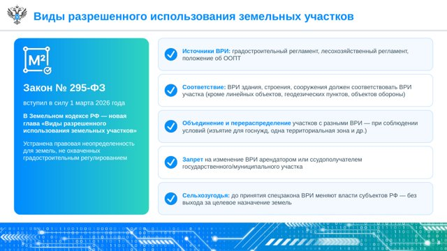

| Поле | Описание | Лимит |
|---|---|---|
| **`title`** | | ≤ 60 |
| **`items`** | Пункты с галочками; формат `"**Лид:** текст"` | 2–6, каждый ≤ 170 |
| `panel` | Градиентная панель слева `{icon, title, subtitle, text:[…]}` | `title` ≤ 20, `text` 1–3 абзаца ≤ 120 |

## `flow` — цепочка шагов
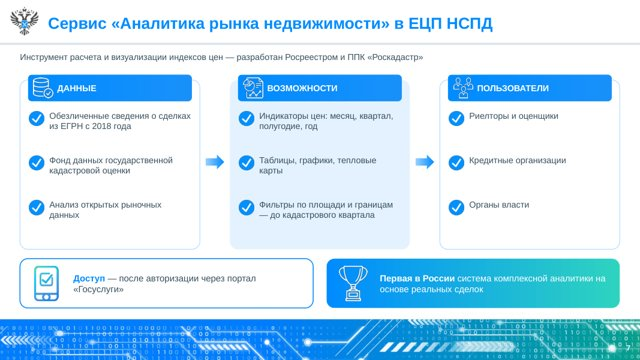

| Поле | Описание | Лимит |
|---|---|---|
| **`title`** | | ≤ 60 |
| **`columns`** | `{title, icon, items:[…], highlight}` | 2–4 колонки, 2–4 пункта по ≤ 70 |
| `intro` | Вводная строка | ≤ 120 |
| `callouts` | До 2 выносок снизу `{icon, text, style}` | ≤ 110 |

При 3 колонках средняя выделяется автоматически.

## `statement` — главный тезис
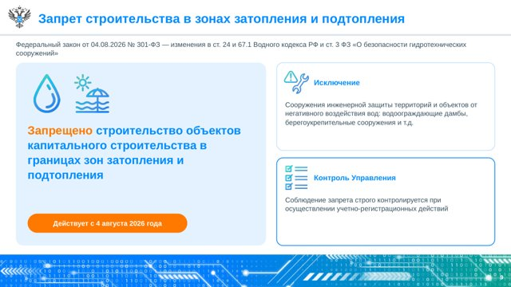

| Поле | Описание | Лимит |
|---|---|---|
| **`title`** | | ≤ 60 |
| **`statement`** | `{icons:[…до 3], text, badge}` | `text` ≤ 120 |
| `cards` | Карточки справа `{icon, title, text}` | 1–3, `text` ≤ 160 |
| `intro` | Реквизиты документа | ≤ 170 (2 строки) |

## `cards_image` — карточки + иллюстрация

| Поле | Описание | Лимит |
|---|---|---|
| **`title`**, **`cards`** | 1–3 карточки `{icon, title, text}` | `text` ≤ 90 |
| `illustration` | По умолчанию `people_house`; `null` — без иллюстрации | |
| `banner` | Градиентный баннер сверху `{icon, text}` | ≤ 150 |
| `chips` | Строка-«чипы» внизу `{title, items:[…], note}` | до 6 коротких названий |

## `table` — таблица на всю ширину
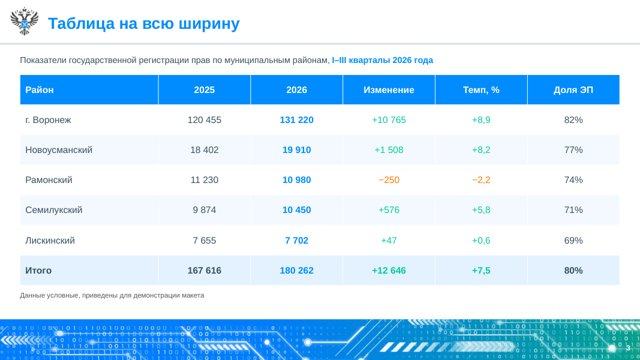

**`title`**, **`table`** (до 10 строк, до 7 колонок), `intro`, `note` (источник данных, сноска).

## `chart` — диаграмма + выводы
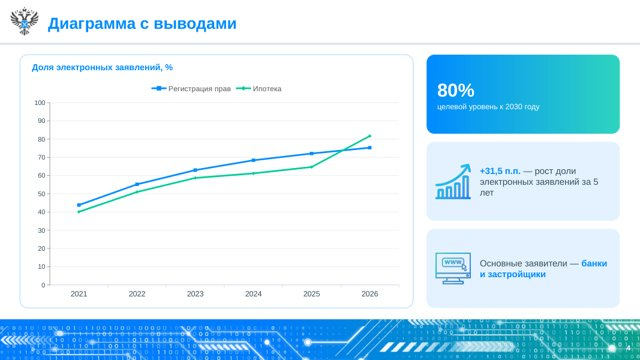

**`title`**, **`chart`**, `chart_title`, `intro`, `insights` — до 4 элементов справа: KPI `{value, label, dark}` или выноска `{icon, text, style}`.

## `timeline` — этапы
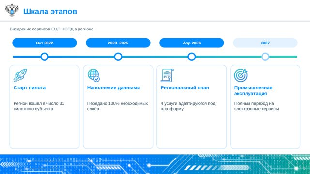

**`title`**, **`steps`** — 3–6 этапов `{date, icon, title, text, done}`; `done: false` — будущий этап (бледная отметка). `intro`.

## `bullets` — тезисы
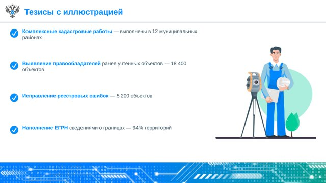

**`title`**, **`bullets`** (3–6, каждый ≤ 140, с разметкой `**лид**`), `intro`, `illustration`.

Запасной макет: если содержание подходит под специализированный макет, используйте его.
